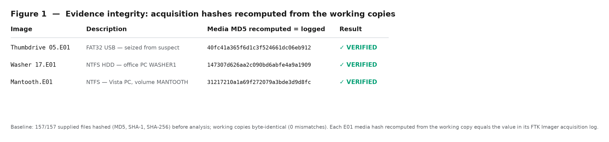
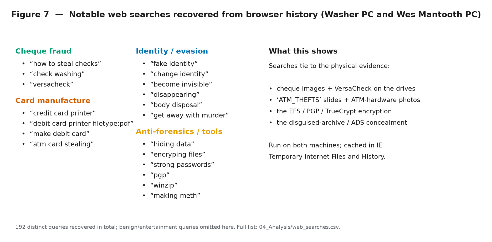
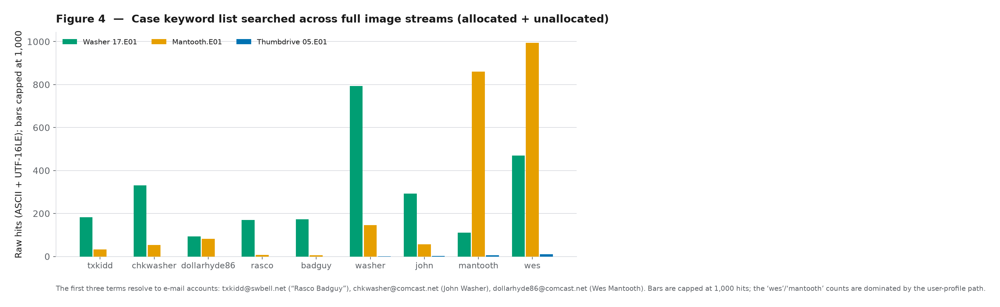
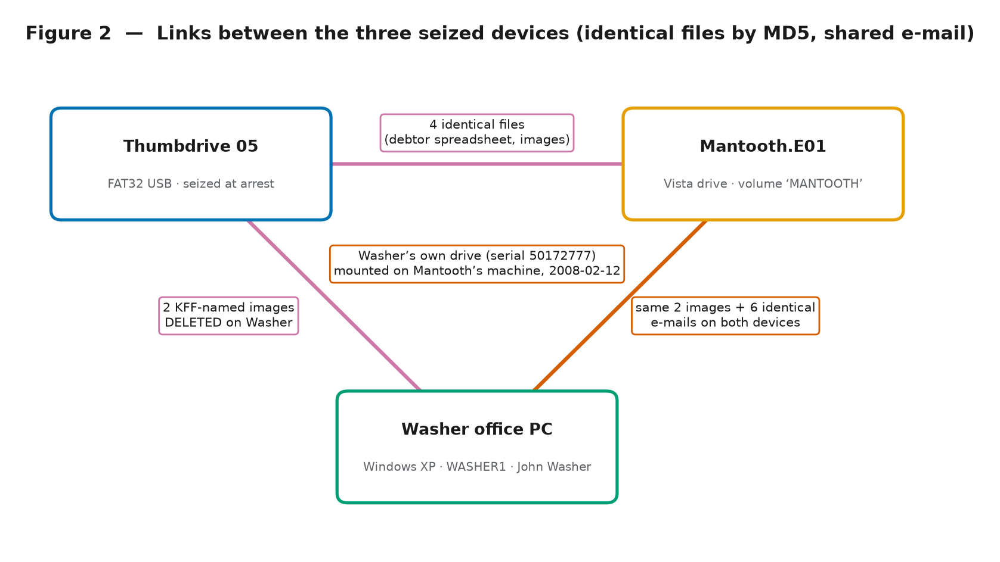
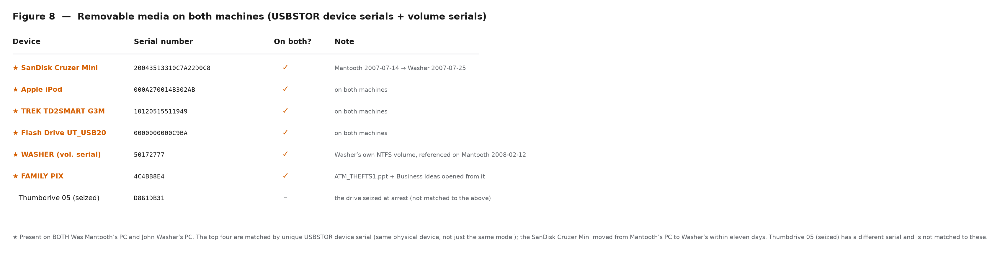
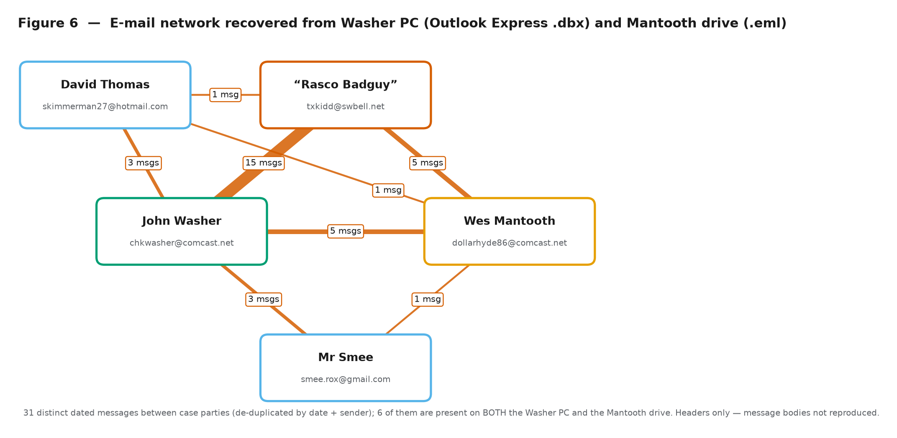
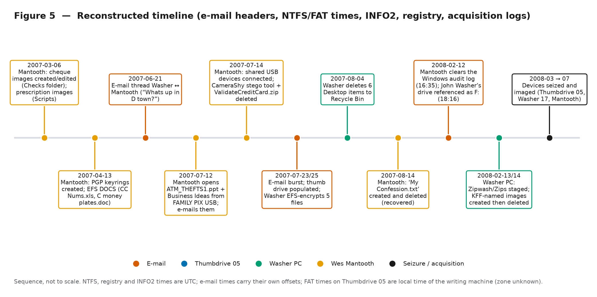

# Mantooth / Washer — Digital Forensic Examination

*Correlated examination of a seized USB thumb drive and two suspect computers.*

**Source case numbers:** 08-1234 / evidence `AD-08-99` (Thumbdrive 05) · 08-12345 /
evidence `AD-08-98` (Washer 17) — from the FTK Imager acquisition logs (acquiring
officer N. Drehel).
**Subjects:** Wesley "Wes" Mantooth · John Washer

## Case premise

Wes Mantooth and John Washer are under investigation for a linked scheme of
financial-instrument fraud — counterfeit and "washed" cheques, stolen credit- and
debit-card numbers, counterfeit card manufacture, and ATM-card theft — running
alongside a methamphetamine operation financed through the same network. Three
devices were seized and imaged: Mantooth's home computer, Washer's office computer,
and a USB thumb drive taken from a suspect at arrest.

This examination recovers the digital evidence from those three images to establish
**what the suspects were doing** and **whether the two men were operating together**.
Concealed and encrypted material — EFS-encrypted documents, a password-protected
drug-debt ledger, a hidden alternate data stream, disguised archives and a cleared
audit log — is recovered and decrypted, and the surviving artifacts are then
correlated across the three devices. The sections below document the examination and
its findings; the repository layout is mapped at the end.

## Evidence examined

| Item | Image | Source | OS / filesystem | Acquisition MD5 |
|---|---|---|---|---|
| **Thumbdrive 05** | `Sheldon Thumbdrive.E01` | USB thumb drive, seized from a suspect at arrest | FAT32 | `40fc41a365f6d1c3f524661dc06eb912` |
| **Washer 17** | `Washer 17.E01` | Office computer `WASHER1` (John Washer) | Windows XP | `147307d626aa2c090bd6abfe4a9a1909` |
| **Mantooth** | `Mantooth.E01` | Home computer (Wes Mantooth) | Windows Vista · volume `MANTOOTH` | `31217210a1a69f272079a3bde3d9d8fc` |

`Mantooth.vhd` is a VHD copy of `Mantooth.E01`, not a separate exhibit. Other disk
images held in the working set are unrelated to this case and are excluded from the
repository (see *Repository layout*).

## Evidence integrity

All three images were verified against their acquisition hashes before analysis, and
the working copies are byte-for-byte identical to the originals — so every finding
below rests on evidence that was not altered in handling.



---

## 1. The master key to the whole case: a case-built wordlist

Almost every locked thing in this case was opened with the **same** tool, and it
was not a generic cracking dictionary. Suspects reuse their own vocabulary —
names, slang, handles, the words they type into search engines — so we harvested
a wordlist *from the evidence itself*:

- the recovered e‑mail transcript and document bodies,
- the browser search history (`web_searches.csv`),
- every file and folder name in the Mantooth MFT,
- plus a hand-seeded list of case slang (drug terms, character names, the
  suspects' handles).

The harvester (`scripts/build_case_wordlist.py`) produced **146,561 unique words**
(`04_Analysis/case_wordlist.txt`). That one list is what cracked the Windows
account hashes, the Office "password to open", and — critically — the EFS
passwords that unlock the encrypted documents. If there is a single technique to
take away from this case, it is this: **build the dictionary out of the suspect's
own words before you reach for rockyou.**

The search history alone practically narrates the intent — queries like
*"making meth"*, *"atm card stealing"*, and *"body disposal"* are sitting in
`04_Analysis/web_searches.csv`, and the slang in them (`meth`, `smack`) is exactly
what turned out to be the passwords.



The same case terms, searched as raw strings across the full image streams
(allocated *and* unallocated), cluster exactly where you'd expect — `wes` and
`mantooth` saturate the Mantooth drive, the e-mail handles light up Washer:



---

## 2. Passwords recovered — and one revealing twist

| Protected thing | Password | How it was found |
|---|---|---|
| Wes Mantooth's EFS / DPAPI key (Mantooth) | `tooth` | case wordlist vs. the DPAPI master key |
| Washer **Administrator** (logon *and* EFS) | `meth` | case wordlist vs. the SAM NT hash |
| Office 97 drug ledger — RC4 "password to open" | `smack` | case wordlist vs. the workbook's RC4 verifier |
| An e‑mailed document (see §2.1) | `supercallifragilistic` | hidden in an NTFS alternate data stream |

**The twist worth knowing about.** On Washer, `meth` is clean: its NT hash
(`090d5be9…`) is *byte-for-byte* the Administrator hash in the SAM, so `meth` was
genuinely the Administrator's live logon password and the key to his EFS files.

Mantooth is more interesting. `tooth` reliably unlocks Wes Mantooth's DPAPI master
keys (5/5) and therefore his EFS documents — but the NT hash of `tooth`
(`4f892a81…`) does **not** match Wes Mantooth's SAM hash (`511bc1d6…`). In other
words, **`tooth` was not his final Windows login password.** The account password
had been changed, yet the EFS/DPAPI key chain still surrenders to the *original*
password. This is a standard but easily-missed DPAPI property: master keys stay
bound to the credential that created them (and their history), so the password
that opens the encrypted data is not necessarily the one on the current account.
Cracking the live SAM hash alone would never have opened these files.

### 2.1 A password hidden in an alternate data stream

One password wasn't cracked at all — it was *hidden*. The file
`readthis.txt` on Mantooth looks like a dull article about bad checks. But it
carries an NTFS **alternate data stream** (`readthis.txt:password`) whose contents
are:

> *the password for the doc I'm sending you is:* **supercallifragilistic**

A classic ADS stash: innocuous cover file, the real secret riding along in a
stream that doesn't show up in a normal directory listing. Both the visible file
and the hidden stream are preserved under `03_Extracted/ADS_Mantooth/`.

---

## 3. Breaking EFS offline — the hard part

The encrypted documents under `…/Wes Mantooth/Documents/EFS DOCS/` (Mantooth) and
`…/Administrator/My Documents/` (Washer) are **Windows EFS**-encrypted. They look
like pure gibberish with no password prompt — which is exactly how EFS behaves:
it's transparent to the owning account, so once a file is pulled out from under
that account you're left holding the raw ciphertext.

We rebuilt the entire EFS key chain **offline, in Python, without FTK/PRTK**:

```
user password  ──▶  DPAPI master key  ──▶  RSA private key  ──▶  per-file FEK  ──▶  plaintext
  (§1,§2)           (SID + password)        (DPAPI-wrapped)      (RSA-unwrapped     (sector CBC)
                                                                  from $EFS attr)
```

Both systems use that same chain — but the **final cipher is different on each**,
and that difference is where the real work was:

### Mantooth (Vista) — EFS **AES‑256**
Per‑512‑byte‑sector CBC using a single **constant** fixed IV
(`121316e9…bead8919`) on every sector of every file. Adding any per-sector offset
*breaks* it. The four documents (`John.doc`, `Wes.doc`, `CC Nums.xls`,
`C money plates.doc`) decrypt to valid Office 97 streams.

### Washer (XP) — EFS **DESX** (and this one fought back)
Washer predates AES-EFS and uses **DESX**, which is not just a different cipher
but a different *IV scheme*:

- **Key expansion** had to be reverse-engineered to match Microsoft's
  implementation (the one `ntfs-3g` documents): `MD5(key ‖ salt)` with two literal
  salts — `"Dan Simon  "` and `"Scott Field"` — producing the inner DES key and
  the two whitening words, and the block operation is DESX "decrypt" implemented
  as an **encrypt** of the inner DES (`in ⊕ DES_encrypt(out ⊕ C)`).
- **Per-sector IV** is **`0x169119629891ad13 + the sector's byte offset`** — i.e.
  the tweak advances by 512 each sector — *not* by sector index.

That IV detail is the breakthrough, and it was caught by one file. An early
version advanced the IV by sector *index* instead of *byte offset*. That version
sailed through the loose checks — the `.doc` files still parsed as OLE, the JPEGs
still rendered — because only the first 16 bytes of each 512-byte sector are
affected, and Office/JPEG tolerate a little early garbage. The file that refused
to lie was **`pee limit.jpg`**, which turned out to **actually be a PNG** (wrong
extension). PNG wraps its image data in a single zlib stream with a running
checksum over the *whole* file, so a corrupted byte every 512 bytes makes the
inflate fail outright. Brute-forcing the IV-offset formula against that
unforgiving zlib stream is what pinned down `byte_offset` (not `sector_index`),
after which **all five** Washer files decoded perfectly.

### Did we miss any encrypted files? No — and we proved it.
Rather than trust a file browser, we scanned the **MFT directly** for the `$EFS`
attribute (`scripts/efs_enumerate.py`). That authoritative sweep returns
**exactly 4 EFS files on Mantooth and 5 on Washer = 9**, every one of which is
accounted for and decrypted. Nothing encrypted slipped past.

> **Where the plaintext lives.** Each encrypted original is kept in place, with a
> decrypted copy beside it named `<name>_decrypted.<ext>` (the RC4 ledger uses
> `_unprotected`). Full inventory with ciphers, credentials and MD5/SHA‑1 of both
> the ciphertext and the plaintext is in
> [`03_Extracted/DECRYPTION_MANIFEST.md`](03_Extracted/DECRYPTION_MANIFEST.md).

---

## 4. What stayed shut — and why that's the correct result

Not everything opened, and in each case the reason is substantive, not a failure
of effort:

- **`CRACK_ME` (TrueCrypt volume, Mantooth\Documents)** — a genuine encrypted
  container. Its password is **not in the case wordlist**, and TrueCrypt's design
  (no header magic, multiple cipher cascades) means there is nothing to brute
  short of a password that was never written down anywhere in the evidence. The
  container is preserved as-is.
- **`secring.skr` / `pubring.pkr` (PGP keyrings)** — these are *keys*, not an
  encrypted message. The private key is passphrase-protected, but there is **no
  separate PGP ciphertext file** in the evidence for it to decrypt. Recovering the
  passphrase would unlock a key that has nothing to open.
- **`cool tool.piz` and Recycle-Bin `Dc2.piz`** — *not encrypted at all.* They are
  ordinary **ZIP archives with a scrambled extension** (`.piz` ↔ `.zip`). Rename
  and they open normally. Worth calling out precisely because "looks weird" is not
  the same as "encrypted."

---

## 5. Tying the two suspects together

Decryption proves *what* the documents say; the rest of the case proves the two
men were working together. Several independent kinds of artifact all point the
same way.

**The same files on three devices.** Content hashing across all images
(`04_Analysis/cross_device_matches.csv`) ties specific files together — the debtor
spreadsheet and images live on Mantooth *and* Thumbdrive 05, two KFF-flagged images
exist as **deleted** files on Washer, and Washer's own drive (volume serial
`50172777`) shows up mounted on Mantooth's machine. These devices were used
together, not independently.



**The same USB sticks on both PCs.** The `USBSTOR` registry keys on each machine
record the *device instance serials* of the removable media that touched them —
and four devices (including a SanDisk Cruzer Mini that moved from Mantooth's PC to
Washer's within eleven days) match by unique serial on both. Same physical sticks,
not just the same models.



*(The full `USBSTOR` enumeration from Washer's `SYSTEM` hive is in
`figures/fig3_usb.png`.)*

**The same e-mail threads on both drives.** 31 distinct messages between the case
parties were recovered — from Outlook Express `.dbx` stores on Washer and loose
`.eml` files on Mantooth — and six of them appear on *both* drives. The handles
tell their own story: Wes Mantooth writes as `dollarhyde86@comcast.net` and John
Washer as `chkwasher@comcast.net`, trading messages with each other and with
contacts like "Rasco Badguy" (`txkidd@swbell.net`).



**And the intent is in the browser history.** `04_Analysis/web_searches.csv` reads
like a to-do list — meth synthesis, ATM-card theft, body disposal, "strong
passwords", "pgp", "winzip". Those same words seeded the wordlist that cracked the
passwords (§1): the suspects' own searches handed us the keys.

---

## A single timeline

Pulling the e-mail headers, NTFS/FAT timestamps, `INFO2` recycle-bin records,
registry hives and acquisition logs onto one axis turns the scattered artifacts
into a sequence — document creation, the EFS encryption events, the shared USB
activity, the deletions, and finally seizure.



---

## Repository layout

- **`README.md`** — this write-up.
- **`figures/`** — the analysis figures referenced above.
- **`01_Hashes/`** — acquisition and working-copy hash manifests (the integrity baseline).
- **`03_Extracted/`** — files exported and carved from the three images, with each
  encrypted original kept beside its `_decrypted` copy; inventory in
  [`03_Extracted/DECRYPTION_MANIFEST.md`](03_Extracted/DECRYPTION_MANIFEST.md).
- **`04_Analysis/`** — derived analysis: the case wordlist, MFT listings, recovered
  e-mail, web-search and keyword results, EFS file-encryption keys, and the SAM
  password hashes.
- **`logs/`** — step-by-step processing logs.
- **`scripts/`** — the Python used throughout.

---

## Reproducing / auditing

The scripts that produced all of the above are in `scripts/` — the EFS chain in
`efs_decrypt.py` (AES/Mantooth) and `washer_efs_decrypt.py` (DESX/Washer), the
completeness sweep in `efs_enumerate.py`, the wordlist harvester in
`build_case_wordlist.py`, and the manifest builder in `make_decryption_manifest.py`.
This repository documents **findings**, not a turnkey pipeline: the scripts record
exactly what was done and can be re-run or debugged against the evidence, but they
assume the analyst's own Python environment.
